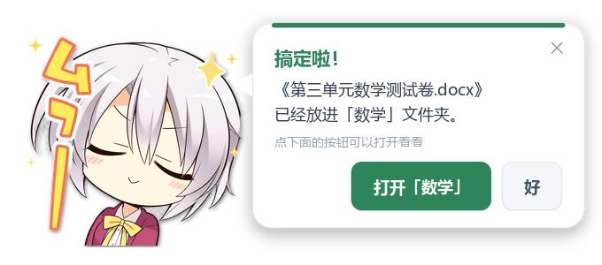
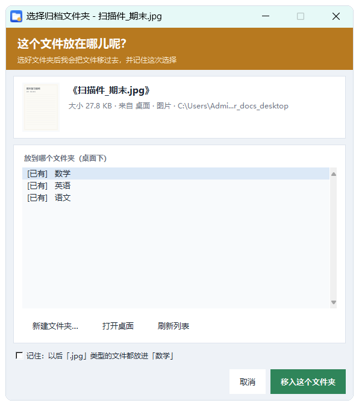
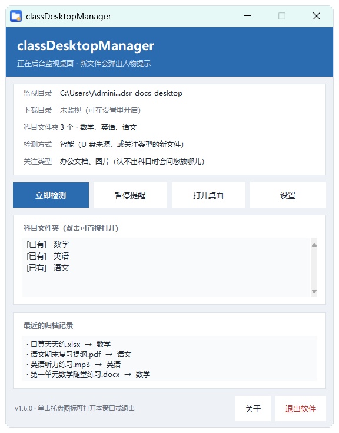
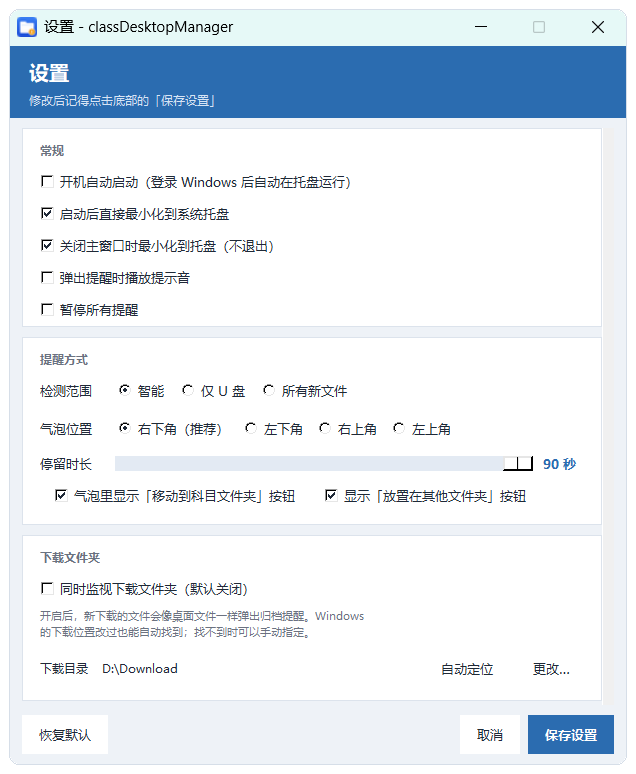
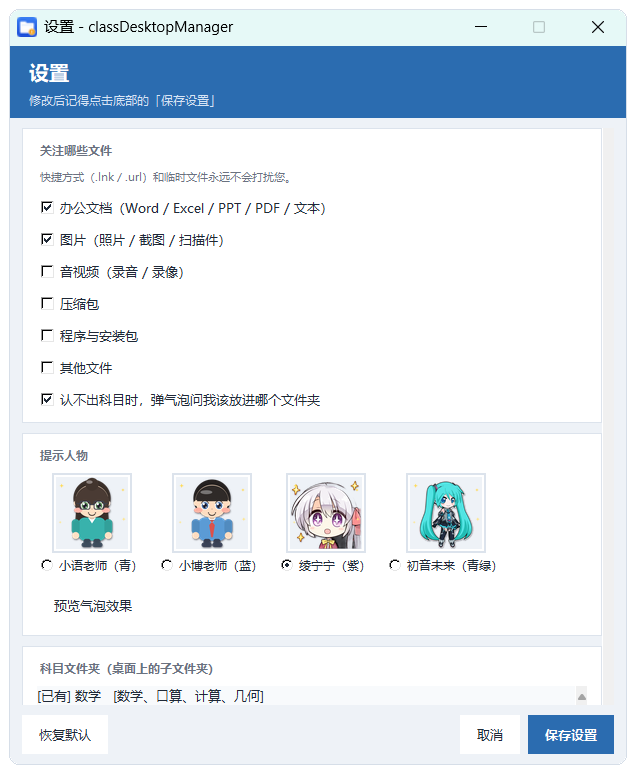

# classDesktopManager

**把桌面上的教学文件，用一句「老师好呀」归进对应的科目文件夹。**

Windows 10 / 11 x64 · 免安装 · 常驻托盘 · 开机自启

**许可证：GPL-3.0-or-later**（GNU General Public License v3.0 或更高版本，详见文末
[许可证](#许可证)）

---

老师把 U 盘里的课件、试卷、照片拷到桌面后，常常就忘了整理：语文的、数学的、
英语的混在一起，期末找一份卷子要翻半天。这个工具会在新文件出现时，用**人物对话
气泡**提醒你归档，认出科目还能**一键移过去**；认不出来就客客气气地问一句
「这个文件放在哪儿呢？」，顺便记住你的选择。浏览器下载的教学资料也能一并照看
（可选，默认关闭）。

<p align="center">
  
</p>

## 功能总览

| 功能 | 说明 |
| --- | --- |
| 🔔 新文件气泡提醒 | 桌面出现文档/图片时，右下角弹出带人物立绘的对话气泡 |
| 🧠 智能识别科目 | 文件名关键词、历史归档相似度、上次记住的扩展名，三种依据给出建议 |
| 📦 一键归档 | 点「移动到「数学」」，文件立刻进入桌面的数学文件夹 |
| ❓ 认不出就问 | 猜不到科目时弹出询问气泡，打开文件夹选择窗口手动指定 |
| 🔁 记住你的选择 | 勾选「以后 .pdf 都放这里」，同类文件以后自动识别 |
| 🖥️ 主界面总览 | 监视目录、下载目录、科目文件夹、检测方式、最近归档记录一目了然 |
| 📥 下载文件夹归档 | 可选开启；同时看管系统下载文件夹，自动定位被改到其他盘的下载位置 |
| ⚙️ 全面可调 | 提醒音、气泡位置/时长、关注的文件类型、4 位提示人物、科目关键词 |
| 🧷 托盘常驻 | 不占任务栏，托盘菜单随时检测、暂停、打开设置 |
| 🚫 永不打扰快捷方式 | `.lnk` / `.url` 与临时文件直接忽略，不会为它们弹气泡 |
| 👆 触摸屏友好 | 按钮 44 逻辑像素高，支持手指点按、按住气泡拖动 |

## 核心功能

### 1. 认出科目：人物气泡提醒 + 一键归档

新文件落到桌面后，气泡会告诉你：文件名、大小、来源（U 盘盘符或桌面），
以及**建议归到哪一科、为什么**——「文件名包含「数学」」「与历史记录相似」
「您上次指定过」。觉得建议对，直接点绿色的**「移动到「数学」」**即可。
（认得出科目时的气泡就是页首那张图。）

如果建议的科目不对，点「放置在其他文件夹」可以改放到别的科目；暂时不想处理就
点「稍后处理」。归档完成后会有第二枚气泡确认结果：

<p align="center">
  
</p>

### 2. 下载文件夹也能一起归档（可选，默认关闭）

到「设置 → 下载文件夹」勾选**「同时监视下载文件夹」**后，浏览器下载完成的课件、
试卷同样会弹出人物气泡提醒归档，归档目标仍然是桌面下的科目文件夹。

下载路径**不用手填**：程序通过 Windows 的「下载」已知文件夹自动定位，即使你把下载
文件夹改到了 D 盘或其他位置也能找到；万一没找到，可以点「更改…」手动指定，点
「自动定位」则恢复自动识别。下方设置截图里的「下载文件夹」一栏就是它。

### 3. 认不出科目：直接问老师

文件名里没有线索、历史里也找不到相似记录时，气泡会变成橙色的
**「老师，这个文件放在哪儿呢？」**，并说明「我没认出它属于哪一科，帮我选一个
文件夹吧」。

<p align="center">
  
</p>

点「选择文件夹…」打开归档窗口：左侧是图片缩略图与文件信息，右侧列出桌面上已有的
科目文件夹（标 `[已有]`）和配置里待建的科目（标 `[待建]`），可以新建文件夹、
打开桌面、刷新列表。勾选底部的**「记住：以后「.jpg」类型的文件都放进「数学」」**，
下次同类文件就能自动识别，不再追问。

<p align="center">
  
</p>

### 4. 主界面：一眼看清当前状态

托盘图标双击（或菜单「打开主界面」）即可打开。顶部状态卡显示**监视目录、下载
目录、科目文件夹数量与名称、检测方式、关注的文件类型**；四个大按钮分别是立即检测、
暂停提醒、打开桌面、设置；下方列表标出每个科目文件夹是 `[已有]` 还是 `[待建]`，
**双击**可直接打开对应文件夹；最底部是最近的归档记录，谁进了哪个文件夹一清二楚。
下载目录一行会显示当前是否在监视、监视的是哪个文件夹（没开启时提示到设置里开启）。

<p align="center">
  
</p>

### 5. 设置：按自己的习惯来

设置窗口分六块，改完点右下角「保存设置」生效。

| 常规与提醒方式 | 关注类型与提示人物 |
| --- | --- |
|  |  |

- **常规**：开机自动启动、启动后最小化到托盘、关闭主窗口时最小化到托盘、
  弹出提醒时播放提示音、暂停所有提醒。
- **提醒方式**：检测范围（智能 / 仅 U 盘 / 所有新文件）、气泡出现在屏幕的
  右下角（推荐）/ 左下角 / 右上角 / 左上角、气泡停留 5～60 秒、是否显示
  两枚操作按钮。
- **下载文件夹**：开关「同时监视下载文件夹」（**默认关闭**），显示自动定位到的
  下载目录；「更改…」手动指定，「自动定位」恢复按 Windows 设置自动识别。
- **关注哪些文件**：办公文档、图片、音视频、压缩包、程序与安装包、其他；
  快捷方式（`.lnk` / `.url`）和临时文件永远不会打扰。还能单独开关
  「认不出科目时，弹气泡问我该放进哪个文件夹」。
- **提示人物**：小语老师（青）、小博老师（蓝）、绫宁宁（紫）、初音未来（青绿）
  四位任选，点「预览气泡效果」先看一眼；绫宁宁配了两张立绘，每次弹气泡自动轮换。
- **科目文件夹**：添加 / 编辑 / 删除 / 从桌面重新读取，每个科目可配一组关键词
  （例如「数学、math、数学卷」），关键词会参与自动识别。

### 6. 托盘常驻：不占地方

程序默认最小化在系统托盘，单击图标弹出菜单，双击直接打开主界面：

| 操作 | 效果 |
| --- | --- |
| **单击**托盘图标 | 菜单：打开主界面 / 设置 / 立即检测桌面 / 打开桌面文件夹 / 暂停提醒 / 退出软件 |
| **双击**托盘图标 | 直接打开主界面 |

### 7. 使用起来很顺手

- 气泡**鼠标移上去不会消失**，移开后继续计时，方便慢慢看。
- **触摸屏可以直接用手指点按钮**：按钮高 44 逻辑像素，符合 Windows 触摸目标建议；
  关闭按钮的命中区也放大到 44×44。
- **按住气泡空白处可以拖动**，轻轻抖动不会被误判为拖动。
- 多显示器、不同缩放比例下，气泡按**鼠标所在那块屏**的 DPI 缩放，位置也贴那块屏。
- 所有处理都在本机完成，**不联网、不上传任何文件名**。

## 哪些文件会提醒

| 类型 | 默认 | 说明 |
| --- | --- | --- |
| 快捷方式（.lnk / .url / .website …） | **永不提醒** | 完全没有归档价值 |
| 办公文档（Word / Excel / PPT / PDF / 文本…） | 关注 | 可在设置里关闭 |
| 图片（照片 / 截图 / 扫描件…） | 关注 | 可在设置里关闭 |
| 音视频 / 压缩包 / 程序安装包 / 其他 | 不关注 | 可在设置里打开 |

只有同时满足「**在关注的类型内**」或「**能认出科目**」或「**来自 U 盘**」的文件
才会弹气泡，其余文件静默忽略。

开启「同时监视下载文件夹」后，下载目录里的新文件也按同一套类型规则判断，来源会
显示为「下载」，归档目标同样是桌面的科目文件夹。

## 快速开始

1. 打开 [Releases](https://github.com/olykin/classDesktopManager/releases) 页面，
   下载最新版本里的 `classDesktopManager.exe`；
2. 双击运行，**免安装**，也不需要装 Python；
3. 首次运行会自动常驻托盘，并弹出一个气泡做自我介绍；
4. 把文件复制到桌面，看气泡提示操作即可。

## 数据与隐私

配置、归档历史和日志都保存在本机：

```
%APPDATA%\classDesktopManager\
├─ config.json     设置
├─ history.json    归档历史（用于"相似文件名"识别）
└─ app.log         运行日志（出问题时可以看这里）
```

## 常见问题

**会误移我的文件吗？**
不会。只有你点了「移动」或选择归档后，程序才会移动**这一个**文件，目标是桌面下
的科目文件夹；识别只是给建议，从不自动移动。

**为什么快捷方式从来不提醒？**
`.lnk` / `.url` 指向的只是入口，归档它们没有意义，所以程序在监视层就直接丢弃，
不产生任何事件。

**气泡没弹出来？**
文件可能不在关注类型里，或者被设置里的「暂停所有提醒」拦住了；右键托盘图标看看
是否处于暂停状态，主界面点「立即检测」可以手动补一次。

**下载文件夹里的文件怎么没提醒？**
默认不监视下载文件夹，需要到「设置 → 下载文件夹」勾选开启。若你把下载位置改到了
别的盘，程序会按 Windows 的「下载」已知文件夹自动定位；定位不到时可在同一处点
「更改…」手动指定。

**想彻底退出？**
主界面底栏的「退出软件」，或托盘菜单「退出软件」。

**支持哪些系统？**
Windows 10 / 11，64 位。

## 版本

当前版本 **v1.6.0**。主要变化：新增可选的**下载文件夹监视**（默认关闭），通过
Windows 已知文件夹自动定位下载目录，设置里可开关、可手动指定或恢复自动定位；
主界面新增「下载目录」状态行并固定住底栏，小屏下也不会被内容挤出。

## 开发者

目录结构、线程模型、技术要点、开发期工具、打包与人物素材处理流程，见
[开发说明.md](开发说明.md)。

## 许可证

本项目以 **GNU General Public License v3.0 or later**（GPL-3.0-or-later）发布，
完整条款见 [LICENSE](LICENSE)。你可以自由使用、修改和再分发；再分发时需要保留
同样的许可证，并提供对应的源代码。

```
Copyright (C) 2026 classDesktopManager contributors

This program is free software: you can redistribute it and/or modify
it under the terms of the GNU General Public License as published by
the Free Software Foundation, either version 3 of the License, or
(at your option) any later version.

This program is distributed in the hope that it will be useful,
but WITHOUT ANY WARRANTY; without even the implied warranty of
MERCHANTABILITY or FITNESS FOR A PARTICULAR PURPOSE.  See the
GNU General Public License for more details.

You should have received a copy of the GNU General Public License
along with this program.  If not, see <https://www.gnu.org/licenses/>.
```

